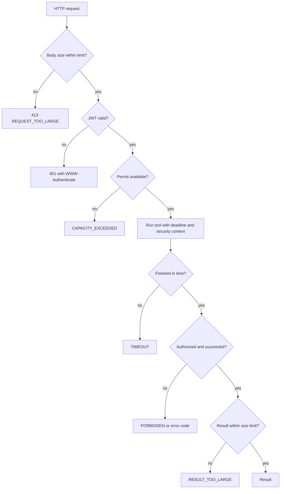

# Execution limits, errors and observability

Every tool call runs through the starter's invoker:



## Limits

| Limit                | Behaviour                                                                          |
|----------------------|------------------------------------------------------------------------------------|
| Request size         | Enforced as a byte limit, also without `Content-Length`; answered with `413`.      |
| Concurrent calls     | Per instance, global and per tool. Calls are rejected immediately, not queued.     |
| Execution deadline   | Global default, overridable per tool. The tool thread is interrupted on timeout.   |
| Result size          | Measured on the serialized result. Oversized results are rejected, never truncated.|

A permit is only released when the tool method has actually terminated, also after a timeout, so work that
cannot be cancelled keeps counting against the concurrency limit. A late result is never delivered after a
timeout. A timeout of a write operation does not mean that nothing has been changed.

## Error contract

A failed call is returned as an MCP tool result with `isError: true`. The structured content has a stable
`code` and a safe `message`:

```json
{"code": "FORBIDDEN", "message": "Access denied"}
```

| Code                | Meaning                                                                      |
|---------------------|------------------------------------------------------------------------------|
| `FORBIDDEN`         | Access denied by method security (also when nested in other exceptions).     |
| `TIMEOUT`           | Execution deadline exceeded.                                                 |
| `CAPACITY_EXCEEDED` | Too many concurrent calls; not executed, can be retried later.               |
| `RESULT_TOO_LARGE`  | Result above the configured size; not returned.                              |
| `INVALID_ARGUMENTS` | The tool method was never reached, or it returned an error result directly instead of throwing `McpToolException` (see below). The message is deliberately generic. |
| `INTERNAL_ERROR`    | Unexpected error. Only a correlation id is returned, details are in the log. |

Authentication failures are HTTP `401` and protocol errors are standard JSON-RPC errors; they are not tool errors.

To report a business error, throw `McpToolException` with your own stable code and a message that is safe to show:

```java
throw new McpToolException("SYSTEM_NOT_FOUND", "The system does not exist");
```

Throwing is the only supported way to report an error: a tool method that instead builds and returns an
error-shaped result itself (`isError: true`) does not go through the classification above at all, since nothing
was thrown for the AOP advice to intercept. The returned result is replaced with `INVALID_ARGUMENTS`, the same
code used when the call never reached the tool method (Spring AI's own argument conversion failing first).

A malformed argument is actually rejected one layer further out than that: the MCP SDK validates it against the
tool's published JSON schema before the call reaches this starter at all. That failure is still a safe,
readable message (it describes the caller's own bad input, for example a wrong type), but it is the SDK's own
plain text, not this starter's `{code, message}` shape -- there is no extension point to reshape it, and
disabling that validation would be worse: Spring AI's own argument binding does not enforce
`@McpToolParam(required = true)` on its own, so a missing argument would instead reach the tool method as
`null` and fail as an opaque `INTERNAL_ERROR` deeper inside it.

The starter never retries a tool automatically.

## Context propagation

The tool runs on a separate virtual thread so the deadline can be enforced. The security context, the logging MDC
and the current observation are propagated to that thread. The MDC is cleared afterwards.

The MDC is copied by the starter itself because Micrometer's context propagation does not carry it unless the
application registers an MDC accessor globally. `traceId` and `spanId` are set again by the tracing bridge when the
`jeap.mcp.tool` observation opens its scope, so they are present either way.

## Tracing

Incoming trace headers (`traceparent`) are handled by Spring Boot's HTTP observation, as for any other endpoint.
Every tool call runs in its own observation `jeap.mcp.tool` (tag `tool`; a failure classified by
`McpToolErrorInterceptor` also sets a `mcp.error.code` tag and flags the observation/span as failed), which is a
child of the request's observation. If the application has a tracer (for example `spring-boot-starter-opentelemetry`)
this is a span of the caller's trace, and everything the tool does, such as outgoing calls, belongs to that trace.
Without a tracer it only produces the `jeap.mcp.tool` timer. The starter has no tracing dependency of its own.

Two failures never reach this observation, so they carry no `mcp.error.code` and do not flag a span: `CAPACITY_EXCEEDED`
is rejected before a tool call -- and its observation -- ever starts, and an unclassified error result (a
`CallToolResult` with `isError: true` but no classified failure, replaced with `INTERNAL_ERROR`) is only detected
after the observation has already closed successfully. Both are still visible on the `jeap.mcp.tool.calls` timer
below, via its own `error` tag.

## Metrics, logs and observers

| Meter                       | Type                | Tags                            |
|-----------------------------|---------------------|---------------------------------|
| `jeap.mcp.tool.calls`       | Timer               | `tool`, `status`, `error`       |
| `jeap.mcp.tool.result.size` | Distribution summary| `tool` (successful calls only)  |

Users and correlation ids are deliberately not used as tags. Every call writes one log line with the tool, status,
error code, duration and result size. Parameters and results are not logged.

Implement `McpInvocationObserver` as a bean to get a summary after every call. Failures of an observer are logged
and never change the result. This is not an audit trail: there is no delivery guarantee.

**Execution model.** Observer notification happens synchronously, after the tool's own deadline window has
already closed: the MCP response is only returned once every observer has completed. With several observers,
they run concurrently with each other (each on its own virtual thread, like a tool call), so the added latency
is bounded by the slowest one, not their sum. Each observer has its own deadline,
`jeap.mcp.execution.observer-timeout` (default `1s`): an observer that doesn't finish in time is cancelled and
logged, same as a failing one, and never delays or changes the tool result beyond that bound. Observers are
meant for fast, in-process summarization, not for slow I/O (which is also why this is not an audit trail) -- the
timeout is a safety net against a misbehaving one, not a budget to design around.

## Rate limiting

Decision: rate limiting per OAuth client is the responsibility of the infrastructure (ingress or API gateway), not
of the starter.

- The gateway sees the HTTP request and the token, so it can limit per client or per IP. The starter has no state
  shared between instances, so a limit implemented in it would only be a per-instance approximation.
- A limit per tool cannot be applied by a gateway, because all tools share one HTTP path and the tool name is part of
  the JSON-RPC body. The starter covers this case with the per-tool concurrency limit
  (`jeap.mcp.tools.<name>.max-concurrent-calls`) and deadline. These are protection limits per instance, not quotas
  per client.
- The starter offers no rate limit properties, because it would not enforce them across instances. If a per-client
  quota inside the service becomes necessary, it should be added as an enforced, documented feature.
